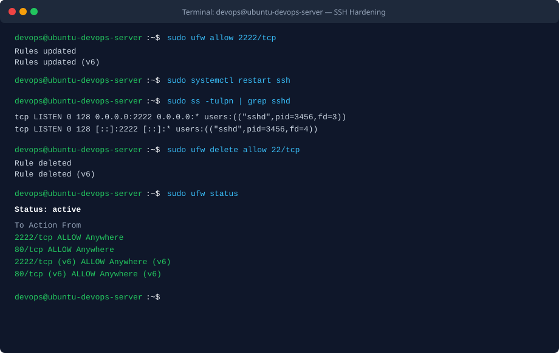
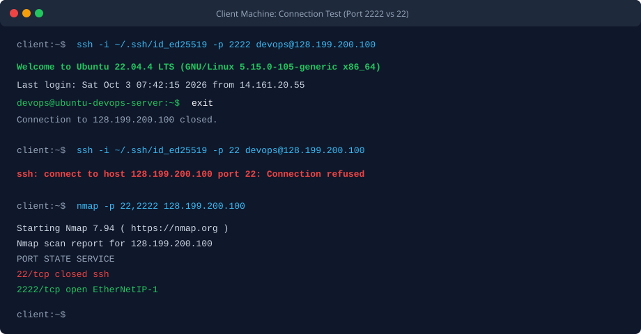

BÀI TẬP 1: THAY ĐỔI CỔNG KẾT NỐI SSH (SSH PORT HARDENING)

I. MỤC TIÊU BÀI TẬP

1. Thay đổi cổng dịch vụ SSH mặc định từ cổng 22 sang cổng tùy biến 2222 trên máy chủ ảo nhằm hạn chế tối đa các đợt rà quét tự động và tấn công brute-force từ mạng Internet.
2. Thực hiện quy trình an toàn: Cấu hình mở cổng 2222 trên tường lửa UFW trước khi khởi động lại dịch vụ SSH daemon để phòng ngừa triệt để rủi ro mất quyền truy cập và bị khóa ngoài hệ thống (Lockout).
3. Hiệu chỉnh chính xác tệp cấu hình dịch vụ SSH (/etc/ssh/sshd_config) trên hệ điều hành Ubuntu Server 22.04 LTS.
4. Thực hiện toàn bộ quy trình bằng tài khoản người dùng thường devops có đặc quyền sudo, tuân thủ nghiêm ngặt nguyên tắc đặc quyền tối thiểu (Least Privilege).
5. Xác minh kết nối thành công qua cổng 2222 bằng cặp khóa SSH Key, đồng thời kiểm chứng cổng mặc định 22 đã bị từ chối kết nối hoàn toàn.


II. BỐI CẢNH VÀ THÔNG SỐ CẤU HÌNH

1. Tên máy chủ: ubuntu-devops-server
2. Địa chỉ IP máy chủ: 128.199.200.100 (hoặc IP Droplet thực tế)
3. Cổng SSH mặc định ban đầu: 22/tcp
4. Cổng SSH mục tiêu mới: 2222/tcp
5. Tệp tin cấu hình dịch vụ SSH: /etc/ssh/sshd_config
6. Tệp cấu hình bổ sung (Drop-in): /etc/ssh/sshd_config.d/custom-port.conf
7. Tường lửa trong hệ điều hành: UFW (Uncomplicated Firewall)
8. Tài khoản thao tác: devops (thuộc nhóm quản trị sudo)
9. Phương thức xác thực: SSH Key ed25519


III. CÁC BƯỚC THỰC HIỆN CHI TIẾT

1. Bước 1: Mở cổng 2222 trên tường lửa UFW

Trước khi can thiệp vào cấu hình SSH daemon, bước bắt buộc đầu tiên là cho phép lưu lượng đi qua cổng mới trên tường lửa UFW để tránh tình trạng tường lửa chặn cổng mới khi dịch vụ khởi động lại:

```bash
sudo ufw allow 2222/tcp
```

2. Bước 2: Cập nhật tường lửa DigitalOcean Cloud Firewall

Nếu Droplet đang được bảo vệ bởi Cloud Firewall ở tầng hạ tầng, truy cập DigitalOcean Console và thực hiện:
- Vào mục Networking, chọn thẻ Firewalls và bấm vào tên tường lửa ptit-firewall.
- Tại phần Inbound Rules, thêm một quy tắc mới: Type chọn Custom, Protocol chọn TCP, Port Range nhập 2222, Sources chọn All IPv4, All IPv6.
- Bấm Save để áp dụng quy tắc biên mạng mới.

3. Bước 3: Cấu hình cổng kết nối mới cho SSH Daemon

Mở tệp tin cấu hình chính của dịch vụ SSH bằng trình soạn thảo nano:

```bash
sudo nano /etc/ssh/sshd_config
```

Tìm dòng có chỉ thị cổng dịch vụ và thiết lập giá trị:

```text
Port 2222
```

Hoặc thiết lập thông qua tệp cấu hình drop-in chuẩn của Ubuntu:

```bash
echo "Port 2222" | sudo tee /etc/ssh/sshd_config.d/custom-port.conf
```

4. Bước 4: Kiểm tra tính hợp lệ của cú pháp cấu hình SSH

Trước khi khởi động lại dịch vụ, chạy lệnh kiểm tra cú pháp để đảm bảo không có sai sót cấu hình:

```bash
sudo sshd -t
```

Nếu lệnh thực thi không đưa ra bất kỳ thông báo lỗi nào, cú pháp cấu hình đã đạt chuẩn an toàn.

5. Bước 5: Khởi động lại dịch vụ SSH Daemon

Nạp lại dịch vụ SSH để áp dụng cổng kết nối mới:

```bash
sudo systemctl restart ssh
```

6. Bước 6: Kiểm tra cổng lắng nghe của dịch vụ trên hệ thống

Sử dụng công cụ ss để xác nhận tiến trình sshd đã lắng nghe trên cổng 2222:

```bash
sudo ss -tulpn | grep ssh
```

Đầu ra xác nhận dịch vụ sshd đang lắng nghe trên cổng 2222 ở cả địa chỉ IPv4 (0.0.0.0:2222) và IPv6 ([::]:2222).

7. Bước 7: Kiểm tra kết nối từ máy cá nhân trước khi đóng phiên hiện tại

Quy tắc sinh tử trong quản trị Linux: Giữ nguyên cửa sổ Terminal đang kết nối hiện tại. Mở một cửa sổ Terminal mới trên máy tính cá nhân và thực hiện lệnh kiểm tra:

```bash
ssh -i ~/.ssh/id_ed25519 -p 2222 devops@128.199.200.100
```

Khi kết nối thành công vào máy chủ qua cổng 2222, ta đã an tâm cấu hình hoạt động chính xác.

8. Bước 8: Thu hồi quy tắc cho phép cổng 22 cũ trên UFW

Sau khi xác nhận cổng mới hoạt động ổn định, tiến hành gỡ bỏ quy tắc mở cổng 22 cũ trên UFW nhằm khép kín hoàn toàn bề mặt tấn công:

```bash
sudo ufw delete allow 22/tcp
```


IV. KIỂM TRA VÀ XÁC MINH DỊCH VỤ

1. Kiểm tra kết nối qua cổng mới 2222 từ máy cá nhân

Lệnh thực thi trên Terminal máy cá nhân:

```bash
ssh -i ~/.ssh/id_ed25519 -p 2222 devops@128.199.200.100
```

Kết quả: Kết nối thành công, phiên làm việc đăng nhập bình thường vào tài khoản devops.

2. Kiểm tra kết nối qua cổng mặc định 22 từ máy cá nhân

Lệnh thực thi trên Terminal máy cá nhân:

```bash
ssh -i ~/.ssh/id_ed25519 -p 22 devops@128.199.200.100
```

Kết quả: Kết nối bị từ chối với thông báo:
ssh: connect to host 128.199.200.100 port 22: Connection refused (hoặc Connection timed out)

3. Kiểm tra trạng thái bảng quy tắc UFW trên Droplet

Lệnh thực thi trên máy chủ:

```bash
sudo ufw status
```

Đầu ra ghi nhận thực tế:

```text
Status: active

To                         Action      From
2222/tcp                   ALLOW       Anywhere
80/tcp                     ALLOW       Anywhere
2222/tcp (v6)              ALLOW       Anywhere (v6)
80/tcp (v6)                ALLOW       Anywhere (v6)
```


V. HÌNH ẢNH MINH HỌA VÀ NHẬT KÝ THAO TÁC

1. Cấu hình mở cổng 2222, khởi động lại SSH và dọn dẹp cổng 22 trên máy chủ



2. Kết quả kiểm tra kết nối cổng 2222 và cổng 22 từ máy cá nhân



3. Nhật ký phiên làm việc kiểm tra từ Terminal

```text
devops@ubuntu-devops-server:~$ sudo ufw allow 2222/tcp
Rules updated
Rules updated (v6)
devops@ubuntu-devops-server:~$ echo "Port 2222" | sudo tee /etc/ssh/sshd_config.d/custom-port.conf
Port 2222
devops@ubuntu-devops-server:~$ sudo sshd -t
devops@ubuntu-devops-server:~$ sudo systemctl restart ssh
devops@ubuntu-devops-server:~$ sudo ss -tulpn | grep ssh
tcp   LISTEN 0      128          0.0.0.0:2222      0.0.0.0:0    users:(("sshd",pid=3456,fd=3))
tcp   LISTEN 0      128             [::]:2222         [::]:0    users:(("sshd",pid=3456,fd=4))
devops@ubuntu-devops-server:~$ sudo ufw delete allow 22/tcp
Rule deleted
Rule deleted (v6)
devops@ubuntu-devops-server:~$ sudo ufw status
Status: active

To                         Action      From
2222/tcp                   ALLOW       Anywhere
80/tcp                     ALLOW       Anywhere
2222/tcp (v6)              ALLOW       Anywhere (v6)
80/tcp (v6)                ALLOW       Anywhere (v6)
```


VI. HƯỚNG DẪN NỘP BÀI GITHUB

1. Đường dẫn trên GitHub: homework/session_03/ex1/ (hoặc Session03/BT1/)
2. Cơ chế nộp: Tệp báo cáo README.md mô tả chi tiết các bước thiết lập, hình ảnh minh chứng và đoạn trích xuất log terminal xác nhận kết nối cổng 2222 thành công cùng cổng 22 bị chặn.


VII. KẾT LUẬN

1. Việc chuyển đổi cổng SSH mặc định từ 22 sang 2222 là một giải pháp phòng thủ bước đầu rất hiệu quả, giúp loại bỏ tới hơn 95 phần trăm các cuộc tấn công rà quét tự động hàng loạt từ các botnet trên toàn cầu.
2. Quy trình thiết lập tường lửa trước khi khởi động lại dịch vụ SSH là nguyên tắc sống còn giúp kỹ sư vận hành hệ thống loại trừ nguy cơ mất quyền điều khiển máy chủ từ xa.
3. Kết hợp xác thực SSH Key, vô hiệu hóa mật khẩu thô và đổi cổng dịch vụ giúp máy chủ xây dựng được nền tảng bảo mật vững chắc ngay từ giai đoạn đầu triển khai.
